If you have ever worked on a growing codebase, you have likely experienced the "Fragile Codebase Syndrome": touching a single line of code in one module silently breaks three unrelated features across the system.

Before diving into individual design patterns, we must address the core architectural guidelines that prevent codebases from deteriorating into unmaintainable monoliths: **The SOLID Principles**.


## 1. The Core Problem: Software Without Design Principles

Without structured guidelines, software design tends to decay over time. Engineering teams usually hit three major roadblocks as a codebase grows:

### A. High Cost of Maintainability
* **The Symptom:** Adding a single new requirement or feature introduces unexpected side effects and bugs in existing features.
* **The Root Cause:** Tight coupling between unrelated modules. When business logic, data persistence, and notification services are mashed into one place, isolation becomes impossible.

### B. Poor Readability & High Onboarding Friction
* **The Symptom:** New engineers spend days or weeks tracing execution flows just to make a minor modification.
* **The Root Cause:** High complexity, violation of single-purpose boundaries, and "god objects" that handle dozens of responsibilities simultaneously.

### C. Fragility & Frequent Regression Bugs
* **The Symptom:** Fixing a bug in Module A systematically re-introduces a previously fixed bug in Module B.
* **The Root Cause:** Lack of abstraction and failure to design for extensibility, forcing developer updates directly into legacy code blocks instead of extending through interfaces.

---

## 2. The Origin: Standardizing Object-Oriented Design

In **2000**, **Robert C. Martin (Uncle Bob)** compiled a set of five fundamental software design guidelines in his paper *Design Principles and Design Patterns*.

These principles were later grouped under the acronym **SOLID** to provide a structured approach to writing clean, maintainable, and scalable object-oriented software.

---

## 3. The SOLID Acronym Breakdown

| Letter | Principle | Core Focus |
| :---: | :--- | :--- |
| **S** | **Single Responsibility Principle (SRP)** | A class should have one, and only one, reason to change. |
| **O** | **Open/Closed Principle (OCP)** | Software entities should be open for extension, but closed for modification. |
| **L** | **Liskov Substitution Principle (LSP)** | Derived classes must be substitutable for their base classes without breaking the application. |
| **I** | **Interface Segregation Principle (ISP)** | Clients should not be forced to depend on interfaces they do not use. |
| **D** | **Dependency Inversion Principle (DIP)** | High-level modules should not depend on low-level modules; both should depend on abstractions. |

---

> **Key Takeaway:** SOLID principles are not rigid laws or framework dependencies—they are architectural guidelines designed to reduce structural complexity and coupling, improve object lifecycle management, and preserve code elasticity under changing business requirements.

---

## Single Responsibility Principle (SRP): Eliminating God Objects

The **Single Responsibility Principle (SRP)** is the foundational letter of the SOLID acronym. While simple in concept, it is one of the most frequently violated rules in object-oriented software development.

### 1. Defining SRP

* **Core Definition:** A class should have **one, and only one, reason to change**.
* **Practical Meaning:** A class should be responsible for performing a single, well-defined task or domain responsibility within the application architecture.

> **Crucial Clarification:** "One reason to change" refers to **stakeholders or actors**. If an accounting team requirement change AND an engineering team requirement change both force you to edit the same Java class, that class violates SRP.

---

### 2. SRP Violation: The "ShoppingCart" Anti-Pattern

In e-commerce systems, a common anti-pattern is combining cart item management, pricing calculations, persistence operations, and receipt rendering into a single class.

#### Bad Design (SRP Violation)

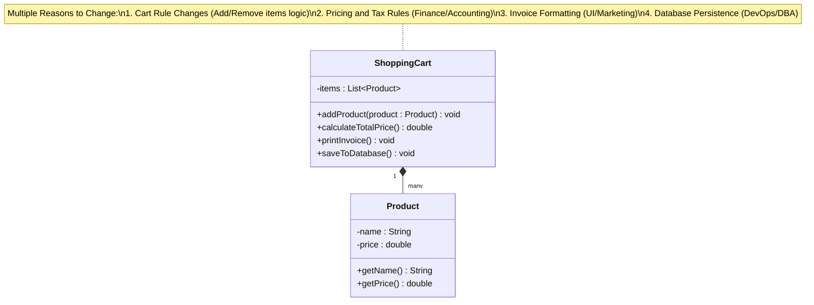

#### Why This Design Breaks
1. **Tight Coupling**: Any change to database schemas or invoice layout forces recompilation and testing of cart modification logic.

2. **Merge Conflicts**: A backend developer updating JDBC logic and a frontend developer modifying printable receipt formats will edit the exact same file simultaneously.

3. **Fragility**: Modifying the invoice formatting code risks accidentally altering cart calculation behavior or breaking database persistence connections.

#### Refactored Clean Design (Applying SRP)
We decouple the responsibilities into focused classes. ShoppingCart manages state, while specialized services handle calculation, printing, and storage.

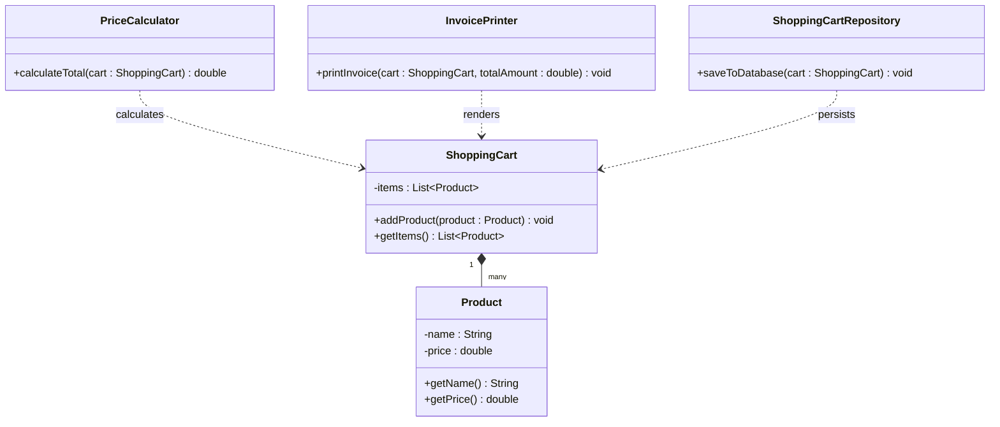

| Class | Single Responsibility | Reason to Change |
| :--- | :--- | :--- |
| `Product` | Represents product data | Product attribute changes |
| `ShoppingCart` | Manages item collections | Cart modification rules |
| `PriceCalculator` | Computes totals and discounts | Tax or pricing policy changes |
| `InvoicePrinter` | Generates formatted receipts | Receipt layout changes |
| `ShoppingCartRepository` | Handles database persistence | DB schema or ORM changes |

> **Key Takeaway:** By separating concerns, each component becomes independently testable, reusable, and resilient to changes across different domain contexts.

---

## Open/Closed Principle (OCP): Extending Behavior Without Modifying Code

The **Open/Closed Principle (OCP)** states that software entities (classes, modules, functions) should be **open for extension, but closed for modification**.

This means you should be able to add new functionality to a component without changing its existing, battle-tested source code.

---

### 1. Defining OCP

* **Open for Extension:** You can add new behavior or features to the class as requirements evolve.
* **Closed for Modification:** The existing core code remains untouched, eliminating the risk of introducing regression bugs into working features.

> **Why it Matters:** Modifying legacy code that is already tested and deployed in production invites unexpected side effects. Designing abstractions allows you to introduce new integrations alongside old ones effortlessly.

---

### 2. OCP Violation: Hardcoded Persistence Types

Consider a `ShoppingCartRepository` class that directly manages saving carts to a database using `if-else` or `switch` statements based on the database type.

#### Bad Design (OCP Violation)

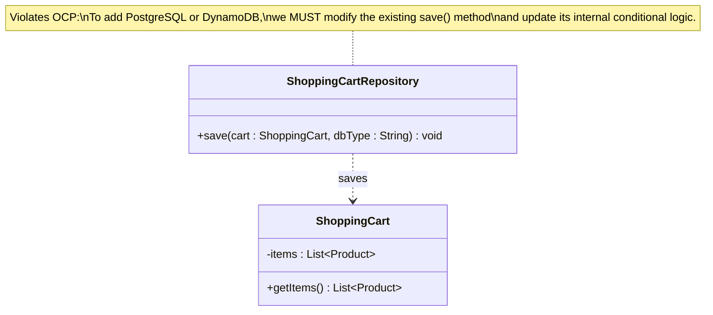

#### Why This Design Breaks
1. **High Risk of Regression**: Every time a new storage engine (e.g., PostgreSQL, Redis) is added, the existing save() method must be modified and re-tested.

2. **Cascading Side Effects**: Modifying legacy conditional blocks risks breaking existing database routes like MySQL or MongoDB that were previously stable.

3. **Monolithic Bloat**: The repository class continuously grows in size and complexity with every new storage mechanism added to the ecosystem.

#### Refactored Clean Design (Applying OCP)
To make the system compliant with OCP, we introduce an abstract `DatabasePersistence` interface. Concrete implementations (`MySqlPersistence`, `MongoDbPersistence`, `PostgreSqlPersistence`) handle specific engine mechanics without touching the repository or orchestrator logic.

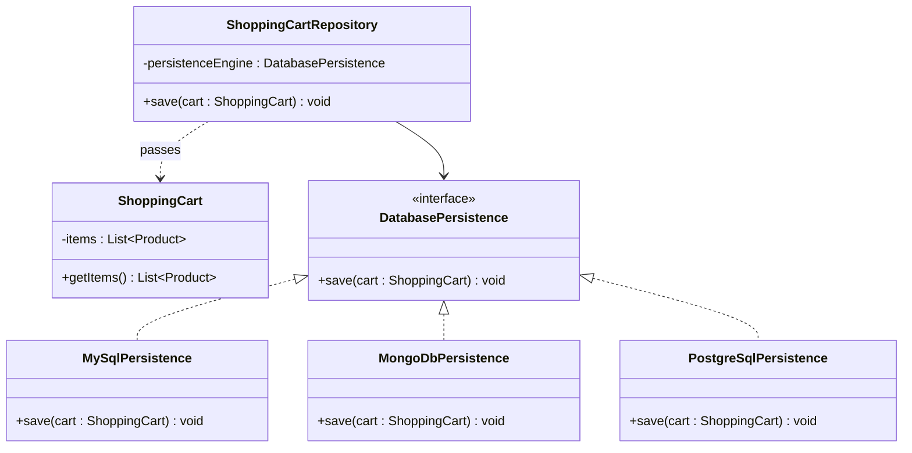

| Metric | Before (Violating OCP) | After (Applying OCP) |
| :--- | :--- | :--- |
| **Adding New DB Engine** | Requires modifying existing methods using conditionals | Requires creating a new class implementing `DatabasePersistence` |
| **Code Modifiability** | High risk of breaking old code paths | Existing classes remain 100% untouched |
| **Coupling** | Tight coupling to concrete database implementations | Loose coupling via polymorphic abstractions |
| **Extensibility** | Fixed and rigid | Elastic and infinitely extensible |

> **Key Takeaway:** OCP leverages polymorphism and interfaces to ensure new system behavior is delivered through new code rather than modified legacy code.

---

## Liskov Substitution Principle (LSP): Ensuring True Polymorphism

The **Liskov Substitution Principle (LSP)** states that **subtypes must be completely substitutable for their base types**.

If class `B` is a subclass of class `A`, then objects of type `A` should be replaceable with objects of type `B` without altering any desirable properties of the program or throwing unexpected runtime exceptions.

> **Type System Context:** Statically typed languages (Java, C#, C++) enforce LSP contracts via compiler-checked method signatures, explicit interface implementations, and type-safe generics. Dynamically typed languages (Python, Ruby, JavaScript) enforce LSP contracts behaviorally through **duck typing**—if an object walks like a duck and quacks like a duck, it satisfies the contract. In duck-typed systems, substitutability is validated at runtime rather than compile time, placing a stronger burden on test coverage to catch LSP violations.

---

### 1. Defining LSP

* **Core Definition:** Derived classes must enhance, not break, the behavior defined by their parent class.
* **Practical Rule:** A child class can extend base behavior, but it should **never narrow down, weaken, or strip away** functionality promised by the parent class interface.

> **Key Rule:** Polymorphism promises that any call valid on a parent type is valid on its derived type. Throwing `UnsupportedOperationException` in a subclass explicitly violates this contract.

---

### 2. LSP Violation: The Fixed Deposit Withdrawal Anti-Pattern

Consider a banking system where `Account` is the parent class for `SavingsAccount`, `CurrentAccount`, and `FixedDepositAccount`. The `Account` class defines a `withdraw()` method. However, fixed deposits do not allow withdrawals before maturity.

#### Bad Design (LSP Violation)

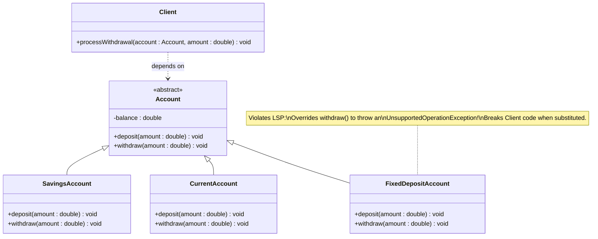

#### Why This Design Breaks
1. **Broken Contract**: Client expects all Account instances to process withdrawals seamlessly.
2. **Runtime Failures**: Replacing a standard Account with FixedDepositAccount causes unexpected crashes at runtime:

```java
Client.processWithdrawal(new FixedDepositAccount(), 10000);
// Throws UnsupportedOperationException!
```

3. **Dirty Client Conditionals**: To prevent crashes, developers are forced to add dirty type checks:

```java
public void processWithdrawal(Account account, double amount) {
    if (account instanceof FixedDepositAccount) {
        // Cannot withdraw!
        System.out.println("Fixed deposits cannot be withdrawn.");
    } else {
        account.withdraw(amount);
    }
}
```

#### Refactored Clean Design (Applying LSP)
To restore substitutability, we split the hierarchy based on capabilities. Base Account handles fundamental operations like deposit(), while a dedicated Withdrawable interface encapsulates withdrawal contracts.

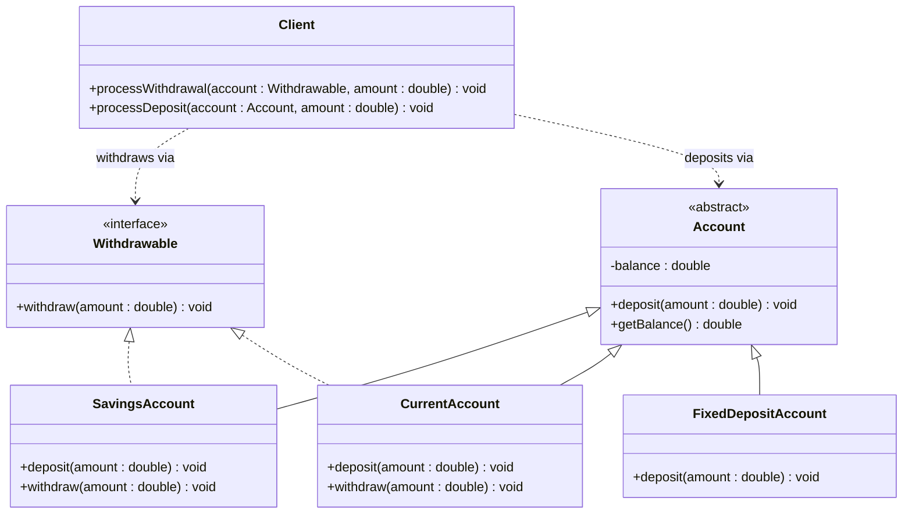

| Metric | Before (Violating LSP) | After (Applying LSP) |
| :--- | :--- | :--- |
| **Substitutability** | Broken (`FixedDepositAccount` crashes on withdrawal) | Guaranteed (Every `Withdrawable` instance safely supports `withdraw()`) |
| **Contract Enforcement** | Runtime exception handling | Compile-time type safety |
| **Client Code Cleanliness** | Polluted with `instanceof` conditional checks | Clean polymorphic execution without type casting |
| **Hierarchy Flexibility** | Forced inheritance of unwanted methods | Natural specialization based on capability contracts |

> **Key Takeaway:** LSP ensures that subtyping reflects true behavioral compatibility, preventing unexpected runtime errors and eliminating defensive `instanceof` checks across client code.

---

### 3. Behavioral Rules & Rules of Engagement for LSP

To guarantee true behavioral substitutability without breaking client code at runtime, compilers and object-oriented architectures enforce three foundational categories of rules: **Signature Rules**, **Property Rules**, and **Method Rules**.

#### A. Signature Rules (Syntactic & Type Guarantees)

Signature rules dictate how method declarations in subclasses interact with the parent class contract.

##### i. Method Argument Rule (Contravariance of Parameters)
* **Rule:** A subclass method override or overload should accept arguments that are of the **same type or broader (supertype)** than the parent method parameter.
* **Why it Works:** If client code passes a broad parameter expected by the parent class, a subclass that accepts an even broader range of types can handle the input without type mismatch or compilation failure.

```
Parent Expects:   [ Standard User ]
Subclass Accepts: [ Standard User | Guest User | Admin User ] (Wider Net)
Result:           Safe substitution — subclass handles everything parent handled and more.
```

> **Practical Language Caveat:** While Liskov's original academic type theory permits contravariant method parameters (accepting supertypes), mainstream statically typed OO languages such as **Java, C#, and C++** enforce **strict parameter invariance** for method overriding. In these languages, changing a parameter type to a supertype does not produce an override—it creates a **method overload** instead. This distinction is critical: an overloaded method has a separate dispatch signature, so it will **not** be invoked via dynamic (runtime) dispatch through a parent-type reference. The parent's original method signature remains the one dispatched polymorphically, and the "broader" overload simply coexists as a separate entry point. True contravariant parameters are supported in a few languages (e.g., Eiffel, some functional languages), but developers working in the Java/C#/C++ ecosystem should treat parameter types as invariant for override purposes.

##### ii. Return Type Rule (Covariance of Return Types)
* **Rule:** An overridden method in a subclass can return a type that is **the same or narrower (subtype)** than the parent class method's return type.
* **Why Java/C++ Allows This:** If a client invokes a parent method expecting an instance of `Account`, receiving a narrower derived type like `SavingsAccount` is completely safe because `SavingsAccount` **IS-A** `Account`.

```
Parent Promises:   Account
Subclass Delivers: SavingsAccount (Narrower Type)
Result:            Client variable of type 'Account' can hold 'SavingsAccount' safely.
```

##### iii. Exception Rule (Narrower Checked Exceptions)
* **Rule:** An overridden method in a subclass can throw **fewer or narrower (subclass) checked exceptions** than the parent method, but **never broader or new checked exceptions**.
* **Why it Works:** Clients wrapping calls in a `try-catch` block expecting `IOException` can seamlessly handle `FileNotFoundException` (narrower subclass), but will crash if the subclass suddenly throws an unhandled `SQLException` or generic `Exception`.

##### Demystifying Variance: Covariance vs. Contravariance

| Concept | Direction | Practical Behavior in LSP Subtyping |
| :--- | :--- | :--- |
| **Covariance** | Moves **down** the hierarchy (Narrower) | **Return types:** Subclass methods return a narrower type than the parent method promises. |
| **Contravariance** | Moves **up** the hierarchy (Broader) | **Method arguments:** Subclass methods accept a broader input type to widen the net without breaking expectations. |

> **Key Takeaway:** LSP substitutability relies on variance rules—subclasses can accept broader inputs (contravariance) and return narrower outputs (covariance) to ensure client code executed against parent contracts never fails at runtime.

---

#### B. Property Rules (State & Invariants)

Beyond signature constraints, LSP dictates how subclasses handle state behavior, preconditions, and postconditions to preserve system invariants.

##### i. Class Invariant Rule
* **Rule:** A child class **must preserve all class invariants** defined by the parent class. It cannot break or mutate the fundamental state constraints established by the parent.
* **Justification & Example:** If the parent class `Account` maintains a class invariant that `balance >= 0`, a child class `OverdraftAccount` or a bug-ridden subclass cannot allow state mutations that set `balance = -500` under operations where the parent explicitly forbids negative balances. Violating parent rules undermines safety assumptions built into client code.

##### ii. History Constraint Rule
* **Rule:** A child class **cannot introduce state mutations** that the parent class explicitly prevents through its public state lifecycle.
* **Justification & Example:** If a parent class `FixedAccount` defines an immutable `accountNumber` that can only be set once during construction, a child class cannot expose a public method like `setAccountNumber(String id)` or allow internal mutations that alter `accountNumber`. Client code relying on parent immutability guarantees would break.

---

#### C. Method Rules (Preconditions & Postconditions)

##### i. Precondition Rule (Cannot Strengthen)
* **Rule:** A child class method **can keep or weaken preconditions**, but it **can never strengthen them**.
* **Justification & Example:**
  * **Password Length:** If parent `Validator` accepts passwords of length `8` or more, child `CustomValidator` can weaken this precondition to accept length `6` or more. However, if the child strengthens the rule to require at least `12` characters, client code passing valid 8-character passwords will fail when the child object is substituted.
  * **Numeric Range:** If parent `RangeChecker` accepts numbers between `0` and `5`, child can widen/weaken the range to `0` to `10`. Strengthening it to `0` to `3` rejects valid parent inputs, breaking substitutability.

##### ii. Postcondition Rule (Cannot Weaken)
* **Rule:** A child class method **can keep or strengthen postconditions**, but it **can never weaken them**.
* **Justification & Example:**
  * **Response Formatting / Initialization:** If parent `DataFetcher` guarantees returning a fully validated, non-null `Response` object with `status = 200`, child `FastDataFetcher` can strengthen the postcondition by returning an enriched `Response` containing additional metadata and strict checksums.
  * **Why Weakening Fails:** If the child weakens postconditions by returning an uninitialized or unvalidated `Response` object with null fields, client code assuming valid parent postconditions will encounter `NullPointerException` or corrupted state at runtime.

---

| Rule Category | Operation Permitted in Child | Operation Forbidden in Child |
| :--- | :--- | :--- |
| **Preconditions** | Keep or **Weaken** (e.g., allow `0-10` instead of `0-5`) | **Strengthen** (e.g., requiring `0-3` instead of `0-5`) |
| **Postconditions** | Keep or **Strengthen** (e.g., guarantee tighter checks) | **Weaken** (e.g., returning unvalidated/null state) |
| **Class Invariants** | Preserve all parent state rules | Modify or break parent invariants |
| **History Constraint** | Respect immutability & state lifecycles | Introduce unauthorized mutations |

> **Key Takeaway:** Subclasses can do more (weaker preconditions, stronger postconditions) but can never expect more from callers or deliver less in results than their parent promised.

---

## Interface Segregation Principle (ISP): Preventing Fat Interfaces

The **Interface Segregation Principle (ISP)** states that **clients should not be forced to depend on interfaces or methods they do not use**.

Instead of creating large, monolithic interfaces that attempt to cover every possible behavior, systems should be built using smaller, highly specific interfaces tailored to concrete client needs.

---

### 1. Defining ISP

* **Core Definition:** Many client-specific interfaces are better than one general-purpose interface.
* **Practical Meaning:** Implementing an interface should never force a class to write dummy implementations, throw `UnsupportedOperationException`, or leave empty method bodies just to satisfy a compiler requirement.

> **Key Rule:** An interface contract should be lean and cohesive. If implementing classes frequently leave methods empty or unused, the interface is bloated and violates ISP.

---

### 2. ISP Violation: The Fat "Shape" Interface Anti-Pattern

Consider a geometry processing system with a general-purpose `Shape` interface containing both `area()` and `volume()` calculations.

While a 3D shape like a `Cube` has both surface area and volume, 2D shapes like `Rectangle` or `Square` do not possess volume.

#### Bad Design (ISP Violation)

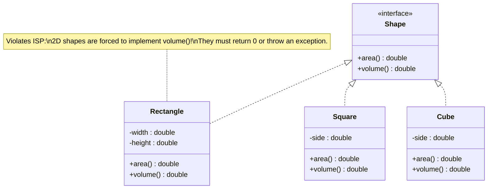

#### Why This Design Breaks
1. **Forced Dummy Implementations:** `Rectangle` and `Square` are forced to write redundant or misleading implementations for `volume()` (e.g., returning `0.0` or throwing `UnsupportedOperationException`).
2. **Coupling to Unneeded Features:** A client that only works with 2D area calculations is still coupled to 3D volume methods exposed by the fat `Shape` interface.
3. **Rigid Hierarchy:** Adding a new 3D-specific method (like `surfaceArea()`) to `Shape` forces every 2D shape in the codebase to update and re-compile unnecessarily.

#### Refactored Clean Design (Applying ISP)
We segregate the fat `Shape` interface into smaller, capability-focused interfaces: `TwoDimensionalShape` (or `AreaCalculable`) and `ThreeDimensionalShape` (or `VolumeCalculable`).

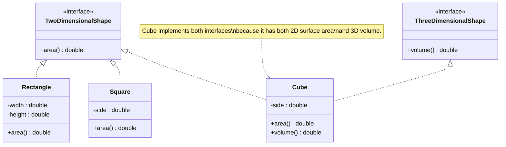

| Metric | Before (Violating ISP) | After (Applying ISP) |
| :--- | :--- | :--- |
| **Interface Design** | Monolithic & Fat (`Shape` with `area()` & `volume()`) | Segregated & Role-Specific (`TwoDimensionalShape`, `ThreeDimensionalShape`) |
| **Class Pollution** | 2D classes contain unused/empty `volume()` methods | Classes only implement methods relevant to their geometry |
| **Coupling** | High (clients depend on unneeded capabilities) | Low (clients depend strictly on required role interfaces) |
| **Maintainability** | Adding 3D methods impacts 2D classes | Changes to 3D interfaces leave 2D classes completely untouched |

> **Key Takeaway:** ISP keeps interfaces targeted and role-specific. Classes only implement what they actually use, preventing code bloat and unnecessary re-compilation cascades.

---

## Dependency Inversion Principle (DIP): Inverting Architectural Coupling

The **Dependency Inversion Principle (DIP)** is the final pillar of the SOLID principles. It governs the direction of dependencies in an application, decoupling core business logic from low-level implementation details.

---

### 1. Defining DIP

* **High-level modules** should not depend on **low-level modules**. Both should depend on **abstractions**.
* **Abstractions** should not depend on **details**. **Details** should depend on **abstractions**.

> **Crucial Relationship:** If your architectural goal is **Open/Closed Principle (OCP)** (extending systems without modifying code), then **Dependency Inversion Principle (DIP)** is the primary mechanism to achieve it. DIP provides the abstract contracts that make OCP possible.

---

### 2. DIP Violation: High-Level Logic Tied to Low-Level Details

Consider a `NotificationManager` (High-Level Module) that directly instantiates and depends on a concrete `EmailService` (Low-Level Module).

#### Bad Design (DIP Violation)

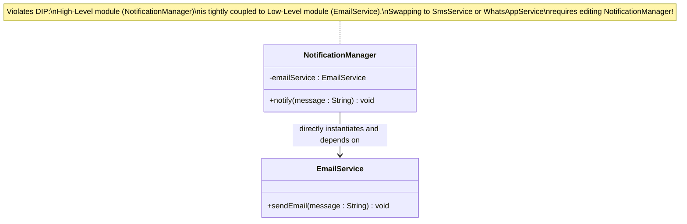

#### Why This Design Breaks
1. **Tight Coupling**: `NotificationManager` cannot exist without `EmailService`.

2. **Inflexible & Hard to Test**: Unit testing `NotificationManager` without sending actual emails requires complex monkey-patching or live network calls.

3. **Breaks OCP**: Adding SMS or Push notifications forces modification of `NotificationManager` source code.

#### Refactored Clean Design (Applying DIP)
We invert the dependency direction by introducing a `MessageSender` interface. Both the high-level `NotificationManager` and low-level implementations (`EmailSender`, `SmsSender`) depend on this abstraction.

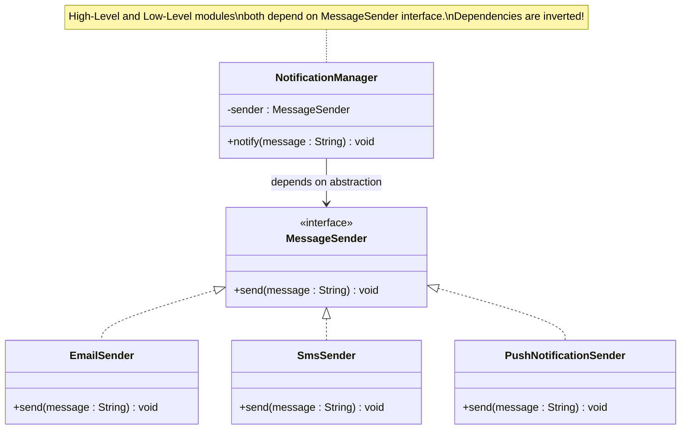

| Metric | Before (Violating DIP) | After (Applying DIP) |
| :--- | :--- | :--- |
| **Dependency Direction** | Top-Down (High-Level → Low-Level Concrete Class) | Inverted (High-Level → Interface ← Low-Level Implementations) |
| **Flexibility** | Rigid & hardcoded to specific implementation | Plug-and-Play architecture via Dependency Injection |
| **Testability** | Hard to mock low-level details | Simple to inject Mock/Stub implementations |
| **Relation to OCP** | Fails OCP (modifications required for new features) | Fulfills OCP (DIP abstraction enables modification-free extensions) |

> **Key Takeaway:** DIP isolates your high-level business rules from volatile low-level details like databases, messaging platforms, or external APIs, ensuring long-term code resilience.

---

## Law of Demeter (LoD): The Principle of Least Knowledge

While not officially one of the core SOLID principles, the **Law of Demeter (LoD)**—also known as the **Principle of Least Knowledge**—is a fundamental design guideline for building loosely coupled, maintainable object-oriented systems.

---

### 1. Defining the Law of Demeter

* **Core Definition:** "Talk only to your immediate friends; don't talk to strangers."
* **Practical Meaning:** A method of an object should only invoke methods on:
  1. The object itself (`this`).
  2. Objects passed in as arguments to the method.
  3. Objects created or instantiated within the method.
  4. Direct instance variables (fields) of the object.

> **Key Rule:** Avoid reaching through an object to interact with a third, indirect object. If you see code like `a.getB().getC().getD().doSomething()`, you are violating the Principle of Least Knowledge.

---

### 2. LoD Violation: The "Train Wreck" Anti-Pattern

Consider a scenario where a `CustomerService` or `OrderProcessor` needs to retrieve a customer's zip code to apply regional taxes.

#### Bad Design (LoD Violation)

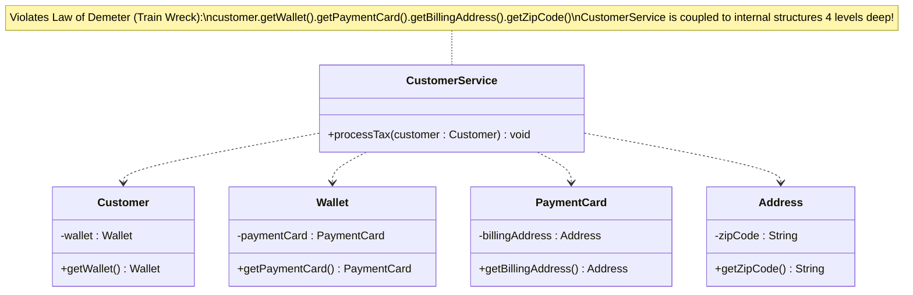

#### Why This Design Breaks
1. **Extreme Structural Coupling:** `CustomerService` must know the exact internal hierarchy of `Customer`, `Wallet`, `PaymentCard`, and `Address`.

2. **Fragility & High Maintenance:** Changing how `Wallet` or `PaymentCard` holds address data instantly breaks `CustomerService` and every other caller navigating that path.

3. **Null Pointer Risk:** Any null value in the chain (`getWallet()`, `getPaymentCard()`, or `getBillingAddress()`) causes a catastrophic runtime `NullPointerException`.

#### Refactored Clean Design (Applying LoD)

We delegate behavioral responsibilities downward so `CustomerService` only interacts directly with its immediate friend: `Customer`.

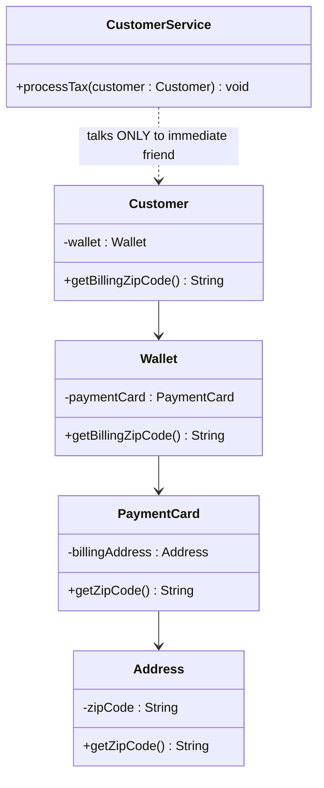

| Metric | Before (Violating LoD) | After (Applying LoD) |
| :--- | :--- | :--- |
| **Code Style** | "Train Wreck" method chaining (`a.getB().getC()`) | Clean, single-level method calls (`customer.getBillingZipCode()`) |
| **Coupling Depth** | Deeply coupled across 4 distinct classes | Coupled strictly to immediate dependencies |
| **Encapsulation** | Exposes internal object graph publicly | Encapsulates structural representation inside the owning object |
| **Testability** | Complex mocking setup required for nested chains | Simple mocking of immediate direct dependencies |

> **Key Takeaway:** The Principle of Least Knowledge preserves structural encapsulation by preventing objects from navigating deep nested relationships, reducing cascading failures when internal object structures change.

---

## LLD Problem Solving Strategy: Top-Down vs. Bottom-Up Approach

When tackling Low-Level Design (LLD) problems in engineering interviews or real-world system architecture, developers typically approach decomposition using two core methodologies: **Top-Down Design** and **Bottom-Up Design**.

---

### 1. Defining the Approaches

* **Top-Down Approach:** Starts at the macro level (High-Level System / Orchestrator / Use Cases) and progressively breaks down complex requirements into smaller, specialized sub-components, domain entities, and abstractions.
* **Bottom-Up Approach:** Starts at the micro level (Core Domain Entities, Value Objects, and Low-Level Utilities) and gradually composes them together to construct higher-level business workflows and orchestrators.

---

### 2. Top-Down Approach (Decomposition)

#### Flow & Execution Strategy
1. **Identify High-Level API / Core Entry Point:** Start with the primary client interface or controller (e.g., `ParkingLotSystem`, `ElevatorController`).
2. **Define High-Level Use Cases:** Outline core workflow methods without worrying about internal implementation details.
3. **Discover Contracts & Abstractions:** Identify missing subsystems and define interfaces for dependencies (e.g., `PaymentProcessor`, `SpotAssignmentStrategy`).
4. **Implement Concrete Low-Level Entities:** Fill in the implementation details for underlying classes and database operations.

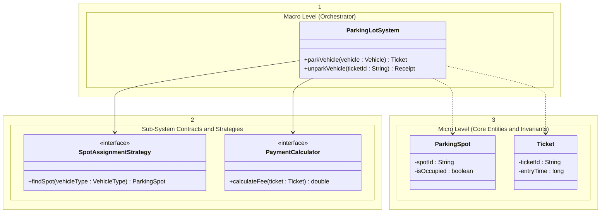

---

### 3. Bottom-Up Approach (Composition)

#### Flow & Execution Strategy
1. **Identify Base Domain Models & Entities:** Begin by defining low-level models, attributes, and data structures (e.g., `Vehicle`, `ParkingSpot`, `Account`).
2. **Define Utility Functions & Strategies:** Build specific behavioral mechanisms (e.g., `NearestSpotStrategy`, `HourlyTariffCalculator`).
3. **Compose Complex Subsystems:** Aggregate base models into higher-order domain objects (e.g., `Floor`, `Zone`).
4. **Build Top-Level Orchestrator:** Connect lower components to expose public APIs for the overall system.

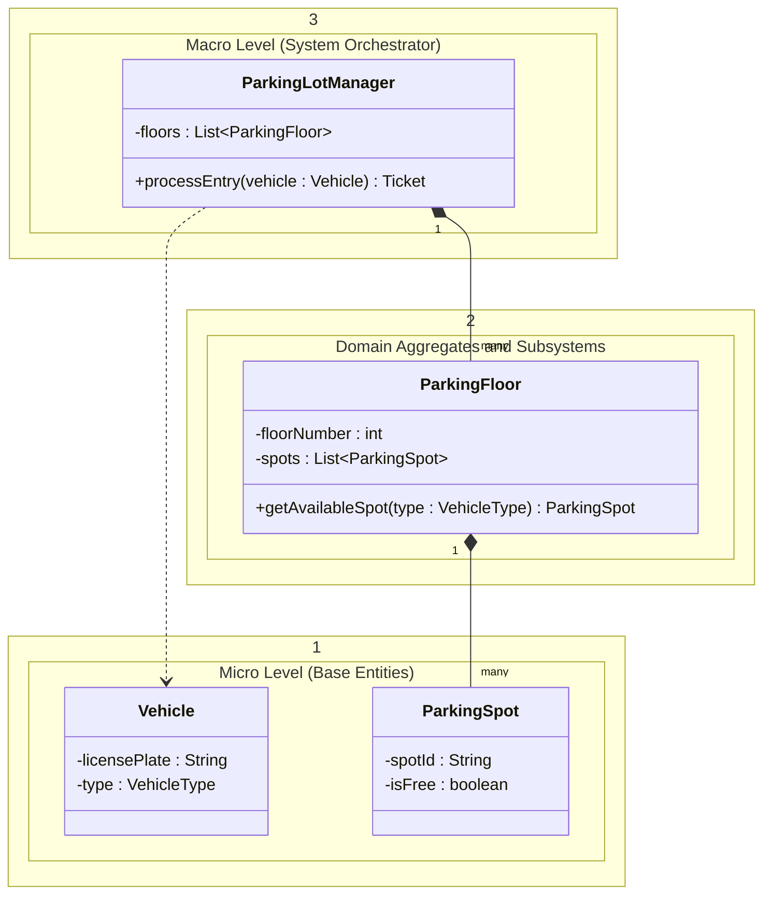

| Metric | Top-Down Approach | Bottom-Up Approach |
| :--- | :--- | :--- |
| **Primary Focus** | User workflows, API contracts, and high-level orchestrators | Core domain entities, data models, and foundational utilities |
| **Best Used For** | Greenfield projects, interview scenarios with shifting requirements | Well-defined domains with strict data invariants or reusable libraries |
| **Risk Factor** | Risk of missing low-level data constraints or physical realities | Risk of creating unused abstractions or misaligned orchestrators |
| **DIP & OCP Alignment** | High (naturally drives creation of interfaces and abstractions first) | Moderate (requires refactoring later to extract clean interfaces) |

> **Key Takeaway:** In machine coding and LLD interviews, a hybrid approach works best: use **Top-Down** to clarify high-level use-cases and define clean abstractions (DIP), then apply **Bottom-Up** to build small, robust domain entities before assembling the final system orchestrator.

---

## Practice Problem: Design a Document Editor

### Bad Design (SOLID Violations)

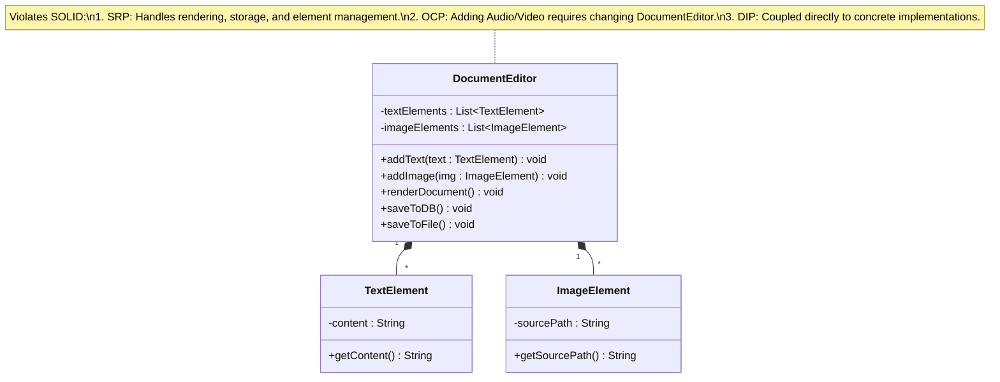

### Good Design (Applying SOLID)

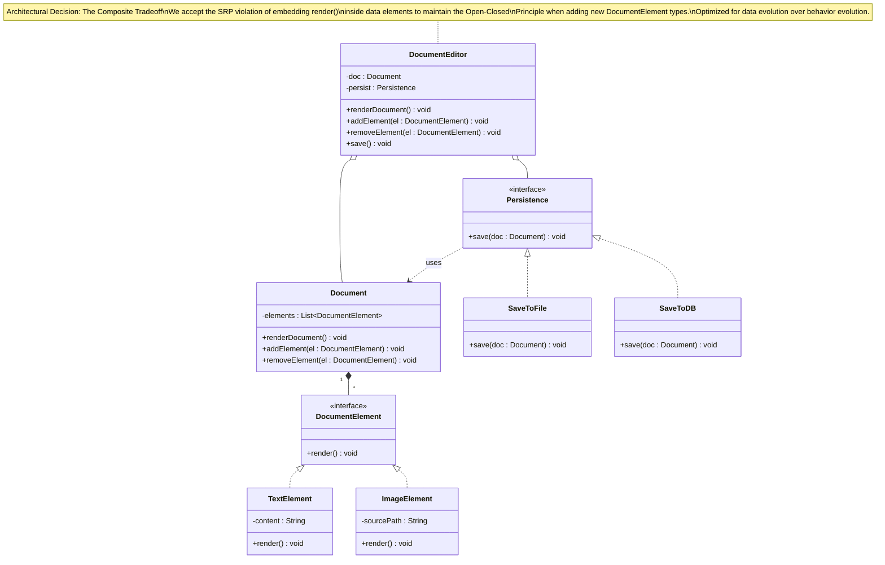